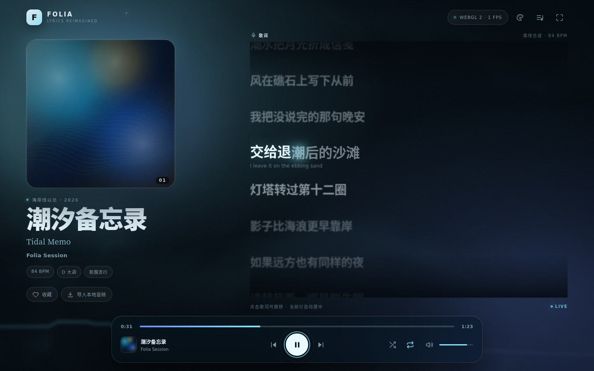

# gihao6_Folia_Player

> **已发布**：华为云开发者作品展览馆 ·「布道活动-广东工商职业技术大学」专区  
> 作品页：https://gallery.developer.huaweicloud.com/gallery/007b000ca7800000


一个以「全屏沉浸式歌词」为核心的音乐播放器。纯前端、零构建、可离线运行，支持 WebGL GPU 可视化、16 种歌词样式、网易云 / QQ 音乐自建 API、Navidrome / Subsonic、本地文件与在线直链。

> 本仓库是 [chthollyphile/folia-major](https://github.com/chthollyphile/folia-major) 的 fork，整体按 AGPL-3.0 分发；原创代码同时保留 MIT 授权。  
> 设计思路参考了开源项目 [chthollyphile/folia-major](https://github.com/chthollyphile/folia-major) 的「全屏沉浸歌词」产品理念。**本仓库的全部前端代码、曲目、歌词、封面与视觉素材均为独立原创实现，不包含原项目的代码或素材**（原项目为 AGPL-3.0）。



## 功能

- **三首原创离线合成曲**：《潮汐备忘录》《霓虹解剖》《纸月亮》，由 Web Audio API 在本地合成，包含和弦、贝斯、琶音、主旋律、鼓组与混响。
- **16 种歌词样式**：诗、商籁、浮名、诗行、凝彩、倾诉、绘光、回环、花火、莫奈、流光、时计、心象、群唱、云阶、镜台。顶栏 ✦ 或 `V` / `Shift + V` 切换。
- **逐字歌词**：已唱白、当前字主题色发光、未唱半透明；点击歌词跳转；支持双语翻译。
- **WebGL GPU 背景**：GLSL 星云、光带与音频频谱，按 GPU 类型自动降级，失败时回退 CSS 渐变。
- **在线音乐源**：
  - 网易云音乐：自建 `NeteaseCloudMusicApiEnhanced`，扫码登录、搜索、在线播放、LRC 歌词。
  - QQ 音乐：自建 `@yakult-green-tea/qq-music-api`，扫码登录、搜索、在线播放、LRC 歌词。
  - Navidrome / Subsonic：填写自己的服务器，同步曲库并在线播放。
  - 在线直链与本地文件导入。
- **完整播放控制**：上下曲、拖动进度、音量、静音、随机、三种循环、播放队列、收藏、全屏、Media Session、屏幕常亮。
- **响应式**：桌面、手机竖屏、手机横屏、平板与超宽屏；`100dvh` 与安全区适配。
- **PWA**：可安装到 Android / 桌面主屏幕，Service Worker 离线缓存前端资源。

## 快速开始

### Web / PWA

```bash
python3 -m http.server 8080
# 打开 http://localhost:8080/
```

Android Chrome 打开部署后的 HTTPS 地址 → 菜单 →「添加到主屏幕 / 安装应用」。

### macOS / Linux

```bash
chmod +x start-player.sh
./start-player.sh
```

macOS 也可双击 `start-player.command`。详见 [docs/DESKTOP.md](docs/DESKTOP.md)。

### Windows 便携版

`start-player.bat` 会启动内置的 Node 运行时、网易云 API（3000）和 QQ 音乐 API（3200），然后打开播放器。该脚本依赖发布包内的 `runtime/` 目录，**源码仓库不包含**运行时。

### 在线源

1. 部署 `NeteaseCloudMusicApiEnhanced`（默认 3000）和/或 `@yakult-green-tea/qq-music-api`（默认 3200）。
2. 确保 API 允许页面来源跨域，并允许凭据（`Access-Control-Allow-Credentials: true`）。
3. 在播放器右上角「音乐源」填写 API 地址，扫码登录后搜索、播放。

详细部署见 [docs/DEPLOY.md](docs/DEPLOY.md)。

### Android APK

仓库已包含 Capacitor Android 工程（`android/`）。安装 Node 20+ 与 Android Studio 后：

```bash
npm install
npm run android:sync
npm run android:open
```

在 Android Studio 中 Build APK。详细步骤与联调注意事项见 [docs/ANDROID.md](docs/ANDROID.md)。

## 16 种歌词样式

| # | 名称 | 英文 | 特征 |
| --- | --- | --- | --- |
| 01 | 诗 | POEM | 衬线居中、宽字距、诗集留白 |
| 02 | 商籁 | SONNET | 字幕式上下细线、居中衬线 |
| 03 | 浮名 | FUME | 烟雾模糊、当前行浮出 |
| 04 | 诗行 | POEM THAT | 等宽字体、行首游标 |
| 05 | 凝彩 | TEMPERA | 主题色块反白 |
| 06 | 倾诉 | TILT | 倾斜透视、左侧光条 |
| 07 | 绘光 | LUMIERE | 描边与多层光晕 |
| 08 | 回环 | CLADDAGH | 按行号旋转的弧线排布 |
| 09 | 花火 | HANABI | 当前行粒子上升 |
| 10 | 莫奈 | MONET | 水彩感、左侧渐变线 |
| 11 | 流光 | CLASSIC | 经典逐字扫光 |
| 12 | 时计 | PENDOLO | 当前行钟摆摆动 |
| 13 | 心象 | CADENZA | 错位碎片排版 |
| 14 | 群唱 | CAPPELLA | 左右交错气泡 |
| 15 | 云阶 | PARTITA | 递增缩进阶梯 |
| 16 | 镜台 | DIORAMA | 3D 透视与倒影 |

## 快捷键

| 按键 | 功能 |
| --- | --- |
| `空格` / `K` | 播放 / 暂停 |
| `←` / `→` | 后退 / 前进 5 秒 |
| `Shift + ←` / `Shift + →` | 上一首 / 下一首 |
| `M` | 静音 |
| `F` | 全屏 |
| `Q` | 播放队列 |
| `S` | 音乐源 |
| `V` / `Shift + V` | 下一种 / 上一种歌词样式 |
| `T` | 切换主题 |
| `Esc` | 关闭面板 |

## 项目结构

```text
index.html              页面结构、PWA 清单、启动页
styles.css              设计令牌、16 种歌词样式、响应式布局
manifest.webmanifest    PWA 清单
sw.js                   Service Worker 离线缓存
icons/                  安装图标
js/data.js              曲目、和弦、歌词时间轴、主题
js/audio.js             离线合成器、播放引擎、FFT
js/visualizer.js        WebGL 背景、程序化封面
js/sources.js           Subsonic、在线缓冲、LRC 解析
js/online.js            网易云 / QQ 自建 API 适配
js/app.js               歌词、队列、主题、PWA、交互
docs/                   部署、Android、GitCode 文档
scripts/                Web 资源同步脚本
android/                Capacitor Android 工程（生成后）
```

## 开发

前端没有打包步骤，直接编辑 `index.html`、`styles.css`、`js/*.js` 即可，刷新浏览器生效。

```bash
npm run sync:web      # 把前端同步到 www/（Capacitor 用）
npm run android:sync  # 同步并更新 Android 工程
npm run serve         # 本地静态服务器
```

## 开源与许可

- 前端代码：[MIT License](LICENSE-MIT)；本 fork 整体按 [AGPL-3.0](LICENSE) 分发
- 曲目 / 歌词 / 封面：本项目原创合成与程序化生成
- 第三方在线音乐 API 不包含在本仓库中，各自遵循其原始许可证，见 [NOTICE.md](NOTICE.md)
- 贡献指南：[CONTRIBUTING.md](CONTRIBUTING.md)
- 安全策略：[SECURITY.md](SECURITY.md)

## 已知限制

- 在线扫码登录依赖本机或远程 API；手机浏览器中的 `localhost` 指向手机自身，Android 端需在音乐源面板填写可访问的 HTTPS API 地址。
- 汽水音乐需要桌面桥接 `qishui-music-api`，纯网页无法扫码，因此未纳入网页端。
- iOS Safari 不支持网页全屏 API；不影响播放。
- 首次进入需要等待离线合成；曲目较长，低端设备可能需要数秒。
- 在线源使用 `fetch + decodeAudioData` 缓冲整首音频，需要 API / 音频服务器允许 CORS。

## 致谢

- 产品理念参考：Folia（chthollyphile/folia-major）
- 在线源服务：NeteaseCloudMusicApiEnhanced、@yakult-green-tea/qq-music-api
- 字体：使用系统字体，无外部字体依赖