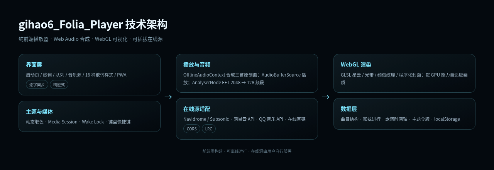

# gihao6_Folia_Player 音乐播放器

gihao6_Folia_Player 是一个以全屏沉浸式歌词为核心的音乐播放器。它完全运行在浏览器中，不需要构建步骤，也不依赖前端框架。项目把「歌词」当作画面本身：当前行放大、逐字点亮、上下文行淡出，并配合 WebGL 生成的流动星云、光带与音频频谱，让播放音乐变成一件可以观看的事情。

## 核心功能

播放器不内置任何曲目，连接用户自己的音乐源、本地音频或在线直链后即可播放。歌词提供 16 种视觉样式：诗、商籁、浮名、诗行、凝彩、倾诉、绘光、回环、花火、莫奈、流光、时计、心象、群唱、云阶、镜台，可通过顶栏按钮或 V 键切换，并会记住上次选择。

播放控制覆盖播放/暂停、上下曲、拖动进度、音量、静音、随机、列表循环、单曲循环、播放队列、收藏、全屏、系统媒体控制与屏幕常亮。界面针对桌面、手机竖屏、手机横屏、平板与超宽屏分别布局，使用 dvh 与安全区适配刘海屏。

## 音乐源

除了本地音频导入与在线直链，项目支持两类自建在线源：Navidrome / Subsonic 曲库，以及网易云音乐与 QQ 音乐的自建兼容 API。用户在音乐源面板填写 API 地址并扫码登录后，即可搜索、在线播放并加载 LRC 歌词。前端不内置任何平台私有接口、扫码逆向或版权音频抓取；在线源能力由用户自行部署的服务提供。

## 技术架构

前端由原生 HTML/CSS/JavaScript 组成。数据层维护曲目、和弦、歌词时间轴与主题；音频层把在线或本地音频解码为 AudioBuffer，用 AudioBufferSourceNode 播放，并把 AnalyserNode 的 FFT 数据压缩成 128 个对数频段；可视化层把频段作为纹理上传 GPU，由 GLSL 片元着色器绘制背景与底部声浪；界面层负责逐字歌词、队列、主题、PWA 与媒体会话。

在线源通过统一的远程歌曲模型接入：搜索只取元数据，播放时再解析音频地址与歌词，随后下载、解码并复用同一套播放与可视化管线。因此本地曲与在线曲在界面上的体验是一致的。

## 多端部署

Windows 提供内置 Node 运行时与两套音乐 API 的便携包，解压双击即可运行。macOS 可双击 start-player.command，Linux 运行 start-player.sh，两者会自动准备 API 与静态服务器。三端也都支持 PWA：部署到 HTTPS 后可在 Chrome/Edge 中安装为独立窗口应用，并通过 Service Worker 离线打开前端资源。Android 端提供 PWA 安装与 Capacitor 工程，可用 Android Studio 构建 APK。

## 开源

项目以 MIT License 开源，包含完整的 README、部署文档、Android 构建说明、贡献指南与安全策略。在线音乐 API 作为第三方组件由用户自行部署，不在仓库内分发。作品的设计理念参考了 Folia 的沉浸歌词方向，但代码、曲目、歌词、封面与全部视觉素材均为独立原创实现。

